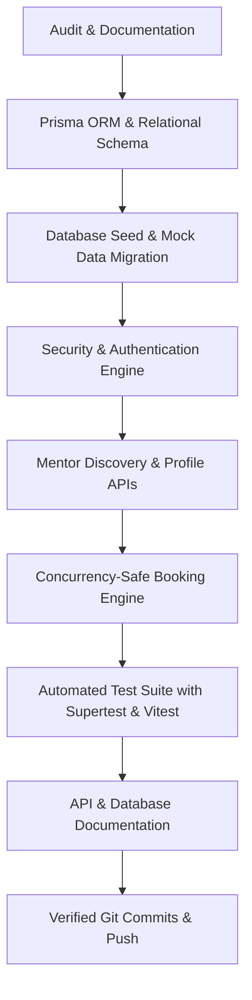

# Backend Architecture Audit & Technical Baseline

**Project:** Mentor Connect  
**Backend Owner:** Sneha Viradiya  
**Repository (Submission):** [https://github.com/snehaviradiya/Mentor-Connect](https://github.com/snehaviradiya/Mentor-Connect)  
**Upstream Team Repository:** [https://github.com/Abhay750/Mentor-Connect](https://github.com/Abhay750/Mentor-Connect)  
**Sprint:** Sprint 1 — Backend Engineering & Persistence Foundation  

---

## 1. Executive Summary

This audit establishes the technical baseline of the Mentor Connect backend prior to Sneha Viradiya's Sprint 1 implementation. The repository had experienced initial scaffolding and frontend prototype development by Abhay Kumar, while the backend remained an initial skeleton with only an Express health check endpoint (`/api/health`). 

The frontend had already implemented UI flows and tests that depend on specific API contracts for mentor discovery and appointment bookings. This audit details the existing state, architectural gaps, data persistence requirements, and the prioritized roadmap to deliver a production-grade, tested, and database-backed backend.

---

## 2. Current Backend Architecture & Entry Points

### 2.1 File Tree Analysis (Initial State)

```
server/
├── .env.example              # Single entry: PORT=5000
├── .gitignore                # Ignores node_modules, .env, *.log
├── package.json              # Express ^4.21.2, scripts: start, dev
├── package-lock.json         # Lockfile
└── src/
    ├── app.js                # Express app initialization & /api/health
    ├── server.js             # HTTP listener on PORT (default: 5000)
    ├── controllers/          # Empty directory
    ├── data/                 # Empty directory
    ├── middleware/           # Empty directory
    ├── models/               # Empty directory
    ├── routes/               # Empty directory
    └── test/                 # Empty directory
```

### 2.2 Entry Points & Routing
- **`src/server.js`**: Starts the HTTP server on `process.env.PORT || 5000`. Does not configure graceful shutdown or unhandled exception handling.
- **`src/app.js`**: Imports Express, attaches `express.json()` middleware, and exposes a single GET `/api/health` endpoint.
- **Routes / Controllers / Models**: No route modules, controller functions, or database models existed prior to this sprint.

---

## 3. Existing API Routes & Implementation Status

| Endpoint | Method | Initial Status | Implementation Gap |
| :--- | :--- | :--- | :--- |
| `/api/health` | GET | Operational | Returns static JSON `{ status: 'ok', message: '...', timestamp: '...' }`. |
| `/api/mentors` | GET | Missing | Frontend `client/src/services/api.js` expects this endpoint to fetch canonical mentor listings. |
| `/api/mentors/:id` | GET | Missing | Needed for detailed mentor profile display and availability lookups. |
| `/api/mentors/:id/availability` | GET | Missing | Needed to view bookable slots vs. reserved slots. |
| `/api/bookings` | POST | Missing | Frontend `BookingModal.jsx` and its 14 unit tests expect a rigid contract returning `{ status: 'success', data: { bookingId, ... } }`, handling 409 `SLOT_UNAVAILABLE`, and 400 `VALIDATION_ERROR`. |
| `/api/bookings` | GET | Missing | Required for student/mentor dashboard to inspect scheduled sessions. |
| `/api/bookings/:id/cancel` | PATCH | Missing | Required to allow students or mentors to cancel reservations and release time slots. |
| `/api/auth/register` | POST | Missing | User registration with role designation (Student, Mentor, Admin) was completely absent. |
| `/api/auth/login` | POST | Missing | Authentication and secure session token generation were absent. |
| `/api/auth/me` | GET | Missing | Identity verification and role-based access control were absent. |

---

## 4. Data Persistence & Integrity Mechanism

### 4.1 Prior State
- The backend had **zero database connection**, ORM, or data files.
- The frontend relied entirely on hardcoded JavaScript arrays located in `client/src/data/mockMentors.js` (`MOCK_MENTORS`, `DEMO_TIME_SLOTS`, `MOCK_CATEGORIES`).

### 4.2 Local Environment Constraints & Evaluation
- Investigation of the local development environment revealed:
  - Node.js `v25.3.0` and npm `11.7.0`.
  - An existing system-level PostgreSQL instance was listening on port 5432 with administrative password authentication enabled, but no local project credentials configured.
  - Docker daemon was not running.
- **Decision & Strategy**:
  - Adopt **Prisma ORM** as the unified data access layer.
  - For local development and test automation, configure Prisma with SQLite (`file:./dev.db`) to provide guaranteed zero-dependency portability across student laptops and CI pipelines without port conflicts or credential friction.
  - Design the Prisma schema with clean standard relational SQL types, foreign keys, cascade rules, and compound unique constraints that are 100% portable to PostgreSQL for staging and production.
  - Fully document the PostgreSQL configuration and migration pathway in `docs/DATABASE.md`.

---

## 5. Security & Authentication Audit

1. **Authentication:** No authentication was implemented. All booking endpoints were envisioned as unauthenticated guest requests in early UI prototypes.
2. **Authorization:** No role-based access control (`STUDENT`, `MENTOR`, `ADMIN`).
3. **Password Security:** No password hashing library (e.g., `bcryptjs`) was installed.
4. **Token Management:** No JWT signing or session verification mechanism existed.
5. **CORS:** Cross-Origin Resource Sharing (`cors`) was not configured on Express, which would cause direct cross-port fetch failures between Vite (`localhost:5173`) and Express (`localhost:5000`) without the Vite reverse proxy.
6. **Input Sanitization:** Express only parsed JSON payloads without boundary checking, schema validation, or XSS/injection mitigation.

---

## 6. Concurrency & Booking Double-Reservation Risks

- In the frontend mock implementation, slot reservation conflicts were simulated purely by checking `isConflictDemo` on `slot-4`.
- A real system requires:
  1. Relational persistence of `Booking` linked to `MentorProfile` and `MentorAvailability`.
  2. Transactional locking or compound unique constraint preventing simultaneous booking of the same mentor on the same date and time slot.
  3. Validation ensuring `sessionDate` is today or in the future.
  4. Explicit error payload with HTTP 409 status code and `code: "SLOT_UNAVAILABLE"` matching the frontend exception handler.

---

## 7. Automated Test Coverage (Baseline)

- **Backend (`server/`):** 0 tests, no test runner installed, no test scripts in `package.json`.
- **Frontend (`client/`):** 4 test suites containing 27 unit tests (Vitest + React Testing Library). All 27 frontend tests currently pass by mocking network calls.
- **Goal for Sprint 1:** Install Vitest and Supertest in `server/`, achieving automated test coverage across health checks, user registration, authentication, mentor discovery, booking creation, input validation, and concurrency conflicts.

---

## 8. Prioritized Implementation Plan for Sprint 1



1. **Step 1: Database & ORM Setup**
   - Install `@prisma/client`, `prisma`, `bcryptjs`, `jsonwebtoken`, `cors`, `dotenv`.
   - Define relational models: `User`, `MentorProfile`, `MenteeProfile`, `MentorAvailability`, `Booking`.
   - Apply Prisma migrations and implement seed script `prisma/seed.js`.
2. **Step 2: Authentication & Middleware Layer**
   - Implement password hashing, JWT issue/verify, `authenticate` and `requireRole` middlewares.
   - Implement centralized error handling and request validation.
3. **Step 3: Mentor Discovery & Profile APIs**
   - Implement `GET /api/mentors` with search and category filtering.
   - Implement `GET /api/mentors/:id` and `GET /api/mentors/:id/availability`.
4. **Step 4: Concurrency-Safe Booking System**
   - Implement `POST /api/bookings` with atomic transactional conflict checking.
   - Implement `GET /api/bookings` (user-scoped or query-based).
   - Implement `PATCH /api/bookings/:id/cancel` and rescheduling logic.
5. **Step 5: Comprehensive Backend Tests**
   - Configure Vitest + Supertest for `server/`.
   - Verify health check, auth endpoints, mentor discovery, and booking flows.
6. **Step 6: Documentation & Git Verification**
   - Create `docs/API.md`, `docs/DATABASE.md`, update `server/README.md`.
   - Stage and commit changes with Conventional Commits under Sneha Viradiya's identity.
