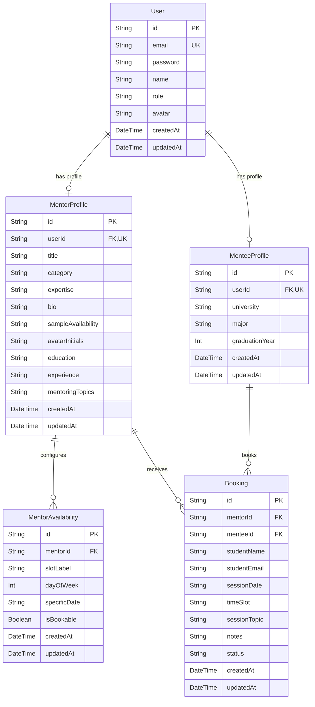

# Mentor Connect — Database Architecture & Persistence Guide

**Backend Owner:** Sneha Viradiya  
**Sprint:** Sprint 1 — Backend Engineering & Persistence Foundation  
**ORM:** Prisma ORM 6.x  
**Development Engine:** SQLite (`file:./dev.db`)  
**Production Target:** PostgreSQL (e.g. Supabase, Neon, AWS RDS, Docker)  

---

## 1. Entity-Relationship (ER) Diagram



---

## 2. Relational Model Definitions & Constraints

### 2.1 `User` (`users` table)
Stores primary identity and credentials for all system participants.
- `id`: Primary key (UUID string).
- `email`: Unique constraint (`@unique`), lowercase.
- `password`: Stored as a salted bcrypt hash (10 salt rounds). Plaintext passwords are never persisted.
- `name`: Display name.
- `role`: Role discriminator string (`STUDENT`, `MENTOR`, `ADMIN`). Default: `STUDENT`.
- Relations: One-to-one with `MentorProfile` and `MenteeProfile`. Cascading delete configured on child profiles.

### 2.2 `MentorProfile` (`mentor_profiles` table)
Stores professional and academic mentorship details.
- `id`: Primary key. Supports both human-readable canonical identifiers (`mentor-1`, `mentor-2`) and UUIDs.
- `userId`: Foreign key referencing `User.id` with unique constraint (`@unique`).
- `category`: Domain grouping (e.g., `Software Engineering`, `Data Science & AI`, `UI/UX Design`, `Cloud & DevOps`, `Product & Strategy`).
- `expertise`: JSON serialized string array of technical skills (e.g. `["React", "TypeScript"]`).
- `mentoringTopics`: JSON serialized string array of consultation focus areas.
- Relations: Has many `MentorAvailability` records and `Booking` records.

### 2.3 `MenteeProfile` (`mentee_profiles` table)
Stores student academic context.
- `id`: Primary key (UUID string).
- `userId`: Foreign key referencing `User.id` (`@unique`).
- `university`: Default: `ADYPU`.
- Relations: Has many `Booking` records.

### 2.4 `MentorAvailability` (`mentor_availabilities` table)
Stores regular and specific time slot configurations for mentors.
- `id`: Primary key (UUID string).
- `mentorId`: Foreign key referencing `MentorProfile.id` with cascading delete.
- `slotLabel`: Formatted time window label (e.g. `10:00 AM – 11:00 AM IST`).
- `isBookable`: Boolean flag allowing mentors to enable or disable specific slots.
- Index: Indexed on `mentorId` for fast calendar rendering.

### 2.5 `Booking` (`bookings` table)
Represents a scheduled mentorship consultation session.
- `id`: Formatted booking ID (e.g. `bk_11223344`).
- `mentorId`: Foreign key referencing `MentorProfile.id` with `onDelete: Restrict` to preserve audit history.
- `menteeId`: Optional foreign key referencing `MenteeProfile.id` (`onDelete: SetNull`).
- `studentName` & `studentEmail`: Captured at time of reservation for verifiable contact.
- `sessionDate`: Date string formatted as `YYYY-MM-DD`.
- `timeSlot`: Time window matching a mentor slot.
- `sessionTopic`: Meeting objective (up to 150 characters).
- `notes`: Optional meeting preparation details (up to 500 characters).
- `status`: Lifecycle indicator (`confirmed`, `cancelled`, `completed`).
- Indexes: Compound index on `[mentorId, sessionDate]` and index on `studentEmail` for rapid search and conflict verification.

---

## 3. Concurrency Safety & Double-Booking Prevention

Double-booking prevention is enforced server-side inside an atomic transaction:

```javascript
const newBooking = await prisma.$transaction(async (tx) => {
  // Check for any active (non-cancelled) booking on the exact same mentor, date, and slot
  const conflictingBooking = await tx.booking.findFirst({
    where: {
      mentorId,
      sessionDate,
      timeSlot,
      status: { not: 'cancelled' },
    },
  });

  if (conflictingBooking) {
    throw new AppError(
      `The selected time slot (${sessionDate} at ${timeSlot}) is already booked for ${mentorName}`,
      409,
      'SLOT_UNAVAILABLE'
    );
  }

  return await tx.booking.create({ ... });
});
```

When an appointment is cancelled via `PATCH /api/bookings/:id/cancel`, its status is updated to `cancelled`, which immediately frees the slot for subsequent bookings without violating referential integrity.

---

## 4. Setup, Migrations & Seeding Commands

### 4.1 Apply Schema Migrations
```bash
cd server
npm run db:migrate
```
Applies pending migrations from `prisma/migrations/` and regenerates the Prisma Client.

### 4.2 Seed Database
```bash
npm run db:seed
```
Seeds:
- 1 Admin user (`admin@adypu.edu.in`)
- 1 Student user (`abhay@adypu.edu.in`) with MenteeProfile
- 8 Mentors corresponding to canonical discovery profiles (`mentor-1` through `mentor-8`) with hashed credentials, profiles, and 4 availability slots each
- 1 Conflict demonstration booking (`bk_seed_demo_01`) for `mentor-1` on slot-4 (`05:30 PM – 06:30 PM IST (Simulated Conflict Slot)`) on `2026-11-01`.

### 4.3 Database GUI (Prisma Studio)
```bash
npm run db:studio
```
Opens interactive database inspection GUI in browser at `http://localhost:5555`.

---

## 5. PostgreSQL Production Migration Guide

The Prisma schema was designed with standard ANSI SQL datatypes and relational constraints to allow seamless migration to PostgreSQL without code rewrites.

### Steps to Switch to PostgreSQL:

1. **Update `prisma/schema.prisma`:**
   Change the datasource provider:
   ```prisma
   datasource db {
     provider = "postgresql"
     url      = env("DATABASE_URL")
   }
   ```

2. **Configure PostgreSQL URL in `.env`:**
   ```env
   DATABASE_URL="postgresql://<user>:<password>@localhost:5432/mentorconnect?schema=public"
   ```
   *(For cloud databases like Supabase or Neon, copy their connection string).*

3. **Run Migration for PostgreSQL:**
   ```bash
   npx prisma migrate dev --name init_postgres
   ```

4. **Seed PostgreSQL Database:**
   ```bash
   npm run db:seed
   ```
